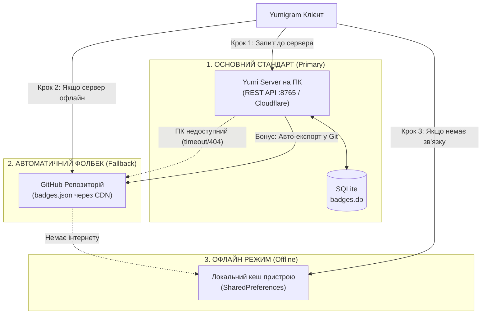

# План реалізації сервера бейджів Yumigram: Yumi Server (Стандарт) + GitHub (Фолбек)

> **Статус:** сервер (`server/`) і клієнтський ланцюжок реалізовано.
> Секрет засновника більше не зашитий у код: сервер створює його у
> `server/data/founder_secret.txt` (або бере з `YUMI_FOUNDER_SECRET`), а в
> застосунку він вводиться один раз у **Бейджики → Секрет засновника**.

Згідно з вимогою, архітектура будується за принципом:
**Yumi Server (ПК) — це основний стандарт системи за замовчуванням, а GitHub — автоматичний фолбек.**  
Supabase повністю виводиться з експлуатації, що остаточно ліквідує проблему з несанкціонованою видачею значків.

---

## 1. Ієрархія джерел (Дворівнева синхронізація)



### Логіка роботи клієнта:
1. **Перший пріоритет (Стандарт):** Додаток завжди надсилає запит на твій **Yumi Server**. Якщо ПК увімкнено — дані миттєво оновлюються з нього.
2. **Другий пріоритет (Фолбек):** Якщо ПК вимкнено або з ним немає зв'язку (таймаут 3 секунди) — клієнт автоматично завантажує `badges.json` із **GitHub**.
3. **Третій пріоритет (Офлайн):** Якщо зв'язку взагалі немає — використовується останній локально збережений кеш на пристрої.

---

## 2. Серверна частина на ПК (`yumi-badge-server`)

* **Технології:** Python 3 (FastAPI або чистий беззалежний скрипт) + SQLite (`badges.db`).
* **База даних:**
  ```sql
  CREATE TABLE IF NOT EXISTS badges (
      user_id INTEGER PRIMARY KEY,
      badge_id TEXT NOT NULL,
      title TEXT NOT NULL,
      obtained_reason TEXT,
      obtained_at TEXT NOT NULL,
      is_active INTEGER NOT NULL DEFAULT 1,
      verified INTEGER NOT NULL DEFAULT 1,
      grantor_id INTEGER NOT NULL DEFAULT 8011880648
  );
  ```
* **Ендпоінти сервера:**
  * `GET /api/badges` — повертає актуальний JSON-масив усіх активних бейджів для клієнтів.
  * `GET /api/badges/{user_id}` — повертає дані одного конкретного користувача.
  * `POST /api/badges/grant` — захищений ендпоінт видачі/редагування (приймає секрет овнера `FOUNDER_SECRET`).
  * `POST /api/badges/revoke` — відкликання/деактивація бейджа.
  * `GET /api/export/github` — генерація JSON для `badges.json` (може автоматично пушити оновлення в GitHub-репозиторій при видачі нового бейджа, щоб фолбек завжди був актуальним!).
* **Веб-панель (Адмінка):**
  * `http://localhost:8765/` — мінімалістичний веб-інтерфейс для тебе:
    * Таблиця з усіма активними бейджами (ID, аватар/ім'я, стиль, причина).
    * Форма швидкої видачі: ввів `user_id` -> вибрав стиль зі списку -> натиснув «Видати».

---

## 3. Зміни в Android-клієнті (Yumigram)

### А. Відключення Supabase
* Усі старі виклики до Supabase у [`MiogramSupabaseBridge.java`](file:///home/user/amenew/TMessagesProj/src/main/java/app/miogram/bridge/badge/MiogramSupabaseBridge.java) відключаються або замінюються на наш новий міст `YumiBadgeServerBridge`.
* Стара база зі спам-записами самовидачі більше **не опитується взагалі**.

### Б. Реалізація ланцюжка "Сервер -> GitHub -> Кеш"
Клієнтський модуль завантаження (`refreshBadges`):
1. Робить швидкий запит до `Yumi Server` (`http://...:8765` або Cloudflare Tunnel).
2. Якщо статус `200 OK` — зберігає дані в пам'ять і в локальний `SharedPreferences`, рендерить значки.
3. Якщо сервер віддав помилку або недоступний (таймаут) — робить запит до GitHub:
   `https://raw.githubusercontent.com/fuckramochka/yuimodules/main/badges/badges.json`.
4. Отримані бейджі кешуються.

### В. Налаштування в додатку ([`AmegramBadgesActivity.java`](file:///home/user/amenew/TMessagesProj/src/main/java/app/amegram/settings/AmegramBadgesActivity.java))
* Секція налаштувань сервера активна **за замовчуванням**:
  * Поле адреси Yumi Server (за замовчуванням задано твій хост / тунель).
  * Індикатор статусу: зелена крапка «Сервер онлайн» або жовта «Фолбек (GitHub)».
  * Кнопка «Синхронізувати зараз».

### Г. Видача бейджів з телефона
* У [`MiogramBadgeGrantSheet.java`](file:///home/user/amenew/TMessagesProj/src/main/java/app/miogram/bridge/badge/MiogramBadgeGrantSheet.java) кнопка «Видати бейдж» надсилає `POST` на твій сервер `http://<SERVER_URL>/api/badges/grant` із секретом овнера.
* Сервер записує новий значок у локальну SQLite та одразу оновлює `badges.json` для фолбеку.

---

## 4. Чому це на 100% вирішує проблему «Бейджики видаються всім»

1. **Жодних відкритих реєстрацій:** У сервері відсутні публічні ендпоінти реєстрації. Створити запис у базі SQLite може **тільки овнер** через адмін-панель або захищений `POST`-запит із телефона.
2. **Повна ізоляція:** Supabase і старі саморобні записи повністю викреслюються з коду.
3. **Строга перевірка:** Навіть якщо хтось спробує підробити запити, клієнт довіряє лише підписаній відповіді твого сервера / офіційного репозиторію.

---

## 5. Порядок дій для реалізації

1. **Крок 1:** Створити готовий Python-сервер `yumi_server.py` у папці `server/` з базою SQLite, адмінкою та підтримкою синхронізації з GitHub.
2. **Крок 2:** Оновити клієнтський клас завантажувача бейджів в Android-проєкті (реалізувати автоматичний ланцюжок: Yumi Server -> GitHub -> Cache).
3. **Крок 3:** Оновити екран налаштувань [`AmegramBadgesActivity.java`](file:///home/user/amenew/TMessagesProj/src/main/java/app/amegram/settings/AmegramBadgesActivity.java) та лист видачі [`MiogramBadgeGrantSheet.java`](file:///home/user/amenew/TMessagesProj/src/main/java/app/miogram/bridge/badge/MiogramBadgeGrantSheet.java).
4. **Крок 4:** Перевірити запуск сервера на ПК і зв'язок з Android-клієнтом.
